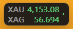

# MH Ticker

_Made with love by [Maria](https://github.com/mariyaholic)._

A price strip that lives in an empty part of the Windows taskbar. Click it and it glides out into
a centred panel; minimise it and it glides back. Prices come from CNBC's public quote
service, so there is **no login, no account and no server**: one exe, double-click, done.

```
XAU 4,153.73   BTC 81,219   S&P 7,743.75
XAG    56.590  DOW 52,048   NAS 29,801.50  ●
```



## Use

- **Run:** double-click `MH_Ticker.exe`. It docks itself into a free part of the taskbar: left of the
  Start button when the icons are centred, otherwise between the app icons and the tray. It follows
  the icons as apps open and close. Only one copy runs at a time.
- **Expand:** click the strip, or left-click the tray icon. The panel has one card per symbol:
  - the price;
  - the day change in % and points, and the previous close;
  - the source and the price's age;
  - a sparkline of the last hour. It already holds the past hour at launch (CNBC 1-minute bars),
    then rolls forward live.
- **Back to the taskbar:** the minimise button (top right), **Esc**, or the tray icon again.
- **Choose the symbols:** right-click → *Symbols*. Tick or untick from a list of 23 (metals, crypto, US futures, oil,
  gas, copper, FX, the dollar index, US yields, VIX, Nikkei, DAX, FTSE, Hang Seng). The strip and the panel change at
  once, no restart. At most 12 show; *Reset to default* brings back the six.
- **Right-click → Position** picks where the strip sits:
  - **Auto** (default): in the taskbar. It uses the gap left of the Start button while that is roomy (icons centred,
    the Windows 11 default). Otherwise it uses the gap between the app icons and the tray (icons aligned left, or a
    crowded centre). With neither (an auto-hide or vertical taskbar), it goes to the bottom-right corner, just above
    the taskbar.
  - **Taskbar, left of Start** / **Taskbar, next to the tray**: that gap only.
  - **Floating**: one row anywhere; drag it, and its spot is saved.
  - **Four corners**: one row in that corner of the screen.
  - **Display 1 / 2 / ...** (only with several screens): which screen, and so which taskbar, it uses.
- **Quit, or other options:** right-click the strip or the tray icon. The menu has *Expand view*
  (the default), *Symbols*, *Position*, *Show strip*, *Always on top*, the current status,
  *Open config folder* and *Quit*. No Task Manager needed.
- **Tray only:** untick *Show strip*. The tray icon still shows every price in its tooltip and opens the panel.
- **Fullscreen apps:** the strip hides itself while a fullscreen app (a game) is in front.

**The tray icon** is a small chart line on a dark tile: green = live, amber = some prices not
fresh (a market is closed), red = offline. Windows 11 puts new tray icons in the hidden **^**
flyout. To keep it on the taskbar, drag it from the flyout onto the taskbar, or turn it on in
*Settings → Personalization → Taskbar → Other system tray icons → MH Ticker*.

## Prices

One batched HTTPS request every 3 s covers every row; the connection is kept alive between
requests. The default six:

| Row | CNBC symbol | What it is | Timing |
|---|---|---|---|
| XAU | `XAU=` | gold spot, USD | real-time |
| XAG | `XAG=` | silver spot, USD | real-time |
| BTC | `BTC.CB=` | bitcoin on Coinbase | real-time |
| DOW | `@DJ.1` | Dow futures, front month | **delayed ~10 min** |
| S&P | `@SP.1` | S&P 500 futures, front month | **delayed ~10 min** |
| NAS | `@ND.1` | Nasdaq 100 futures, front month | **delayed ~10 min** |

- **More in the Symbols menu:** XPT platinum and ETH (real-time); WTI, Brent, natural gas and copper futures
  (delayed); EUR/USD, GBP/USD, USD/JPY and the dollar index; the US 10- and 2-year yields; VIX; Nikkei, DAX,
  FTSE and Hang Seng (delayed).
- **Delayed rows** are labelled *CNBC delayed* in the panel and get 15 min of extra grace before
  they are dimmed as stale.
- **Cash indices** (`.DJI`, `.SPX`, `.NDX`) only move during US hours; the futures trade almost
  around the clock.
- **Unofficial endpoints:** they are public but undocumented, fine for personal use. CNBC can
  change them; if it does, the dot turns red and the tray menu shows the error.

## Settings

`%LOCALAPPDATA%\MH_Ticker\config.json` is written with defaults on first run (*Open config folder*
in the menu). Restart the app after editing it by hand (the Symbols menu needs no restart). Settings:
- `rows`: the shown symbols, each `label`, CNBC `symbol`, `digits` and an optional `name`.
- `catalog`: the Symbols menu's list, same fields. Any symbol CNBC's quote pages show works, e.g.
  `AUD=` for AUD/USD or `@SI.1` for silver futures; add it here and tick it in the menu.
- `poll_s`: seconds between quote requests.
- `stale_after_s` and `delayed_grace_s`: when a price is dimmed.
- `placement` (`auto`, `taskbar_left`, `taskbar_right`, `floating`, `top_right`, `bottom_right`,
  `top_left`, `bottom_left`) and `monitor` (e.g. `\\.\DISPLAY2`; empty = main screen).
- `dock_rows`, `dock_font_pt`: the taskbar grid.
- `font`, `font_pt`, `opacity`, `topmost`.
- `x`/`y`: the saved spot in Floating.

`MH_Ticker --probe` prints one pass over the quotes and the hour of bars, then exits. Use it to
check a new symbol.

## Build

Requires Windows and Rust (stable).

```sh
cargo test
cargo build --release
```

The exe is `target/release/MH_Ticker.exe`; copy it next to this README for double-click use. To
build elsewhere (another drive, say), set `CARGO_TARGET_DIR` or keep an untracked `.cargo/config.toml`
with `[build] target-dir = "..."`; the author's machine uses `D:/mariyaholic-build/mh-ticker/target`.

Plain Win32/GDI: no GUI toolkit, no webview, no GPU context. About 5 MB of private memory and
~0.1% of one core.

## Where it came from

A fork of AO Ticker (Argonaut Oak `apps/ao_ticker`, commit `aaa93149`). The Argonaut Oak sources
(the local Market Terminal feed and the MT5 investor bridge, which needs an MT5 login) are
removed and replaced by CNBC. The strip, the taskbar dock, the panel and its morph animation,
and the tray are the same code.

## Download

Grab `MH_Ticker.exe` from the [latest release](https://github.com/mariyaholic/mh-ticker/releases/latest)
and double-click it. The exe is not code-signed, so Windows SmartScreen may say it "protected your
PC" the first time: choose *More info → Run anyway*, or build it yourself from this source.

## License

[MIT](LICENSE) © 2026 mariyaholic. You may use, change and share this code, as long as the copyright
notice and the license text stay with it. If you build on it, please credit this repository as the
original source.
