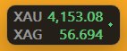

# MH Ticker

_made with love by [maria](https://github.com/mariyaholic)_

This is my little price ticker. It sits in the empty part of your Windows taskbar and asks for almost
nothing: about 5 MB of RAM, and a potato of a CPU won't feel it either. Click the strip and it glides out
into a bigger window in the middle of the screen. Hit minimize and it glides right back into the taskbar.
The prices come from CNBC's public quotes. There's no login, no code, no payment. Just click the .exe file
and it's yours. This one is close to my heart, and I hope it keeps you good company on your taskbar, like
it does for me.

```
XAU 4,153.73   BTC 81,219   S&P 7,743.75
XAG    56.590  DOW 52,048   NAS 29,801.50  ●
```



There are two builds. `MH_Ticker.exe` is the little ticker, exactly as it always was: one theme and the
Symbols page, nothing else. `MH_Ticker_Ultra.exe` is the same engine with 26 themes and 22 fonts, a symbol
picker inside the panel, price alerts, and a candle chart. They run side by side, each with its own
settings file and tray icon. If you just want the little ticker, nothing about the classic exe changed
except the bugs.

## Download

Grab `MH_Ticker.exe` (or `MH_Ticker_Ultra.exe` if you want the themes, alerts and chart) from the
[latest release](https://github.com/mariyaholic/mh-ticker/releases/latest) and double click it. If Windows
prompts you, simply select Run anyway. That's the whole install.

## Everyday use

- Double click the exe and it docks itself into whatever free space your taskbar has, then moves along as
  you open and close apps. Only one copy runs at a time, so you can't accidentally stack them.
- Click the strip (or left click the tray icon) and it expands into a panel with a card for each symbol:
  the price, the day's move, the range, and a little line of the last hour. Point at the line to read the
  price at that moment.
- Click a card to open that symbol on CNBC, or right click it to copy the price. In Ultra, a click locks
  the card instead, and CNBC is an **Open on CNBC** button on the locked card.
- The minimize button, **Esc**, or the tray icon again puts it back in the taskbar.
- Right click the strip or the tray icon for the short menu: *Settings...*, *Expand view*, *Refresh now*,
  *Copy all prices*, *Undo the last ...*, *Show strip*, and *Quit*. No more going to Task Manager when you
  need it gone.
- In Settings → **Symbols** you tick what you want to follow, from 23 symbols (metals, crypto, US futures,
  oil, FX and more), and add any other CNBC symbol you like, up to 24 at once. The strip and the panel
  change right away, no restart.
- The tray icon is my little traffic light: green means live, amber means some prices aren't fresh,
  red means offline.

## Everything else

The fine detail lives in [MH Ticker's guide](https://mariyaholic.github.io/docs/mh-ticker/) on my site:

- [Read the cards](https://mariyaholic.github.io/docs/mh-ticker/#cards) — the hour line, the crosshair, pinning, renaming and undo
- [Change the position](https://mariyaholic.github.io/docs/mh-ticker/#position) — taskbar sides, floating, corners, monitors
- [Change the look](https://mariyaholic.github.io/docs/mh-ticker/#look) — all 26 themes, the 22 fonts, resizing the panel
- [Accessibility options](https://mariyaholic.github.io/docs/mh-ticker/#accessibility) — contrast theme, animation, panel size
- [Read the candle chart](https://mariyaholic.github.io/docs/mh-ticker/#chart) — ranges, volume, suspect data
- [Set alerts](https://mariyaholic.github.io/docs/mh-ticker/#alerts) — presets, repeat, fast moves, mute and quiet hours
- [Send alerts to a webhook](https://mariyaholic.github.io/docs/mh-ticker/#webhook) — Discord, Slack, ntfy
- [Use the keys](https://mariyaholic.github.io/docs/mh-ticker/#keys) — every key in the panel and on the chart
- [Start with Windows and set a hotkey](https://mariyaholic.github.io/docs/mh-ticker/#startup)
- [Control the network use](https://mariyaholic.github.io/docs/mh-ticker/#network) — traffic, fallback sources
- [Use the About page](https://mariyaholic.github.io/docs/mh-ticker/#about) — updates, diagnostics, the data meter
- [The settings file](https://mariyaholic.github.io/docs/mh-ticker/#settings) — every config field
- [Check the price feed](https://mariyaholic.github.io/docs/mh-ticker/#probe) — `--probe` and saved answers
- [Build from source](https://mariyaholic.github.io/docs/mh-ticker/#build)
- [Closed markets](https://mariyaholic.github.io/docs/mh-ticker/#closed) — why a weekend gold quote sits still

## License

[MIT](LICENSE) © 2026 mariyaholic - Use it, change it, share it, just keep the copyright notice and the license
text with it. And if u build something on top of it please credit this repo as the original source!

Thank you for stopping by. ♡
