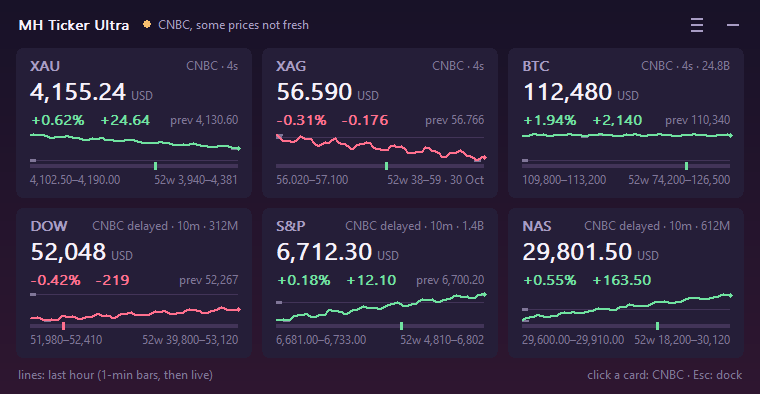

# MH Ticker

_made with love by [maria](https://github.com/mariyaholic)_

A little, extremely resource efficient (~5 MB RAM, and any potato CPU won't feel it) price ticker that sits in the empty part of ur windows taskbar. Click it and it glides out into a
bigger window in the middle of the screen, hit minimize and it glides right back into the taskbar. Prices
come from CNBC's public quotes. You don't need any login, code, payment, whatever. Just click the .exe file!
```
XAU 4,153.73   BTC 81,219   S&P 7,743.75
XAG    56.590  DOW 52,048   NAS 29,801.50  ●
```


And the panel, in `aurora` (every theme is in [shots/](shots/) — rendered by the app itself):



## Two builds, one engine

Same source, same network code, same everything that makes it correct. What differs is where the
effort went:

| | `MH_Ticker.exe` | `MH_Ticker_Ultra.exe` |
|---|---|---|
| Look | one theme, exactly as it always was | **26 palettes in 4 tiers** plus 13 fonts — see [THEMES.md](THEMES.md) |
| Symbols | the *Symbols* menu | that **plus a picker strip inside the panel** |
| Alerts | — | price alerts, tray balloon, optional **Discord/Slack/ntfy webhook** |
| Memory after a minute | ~5.7 MB | ~5.8 MB |

They run side by side (separate settings files, separate tray icons). The classic exe keeps its name
and its look on purpose: if you just want the little ticker, nothing about it changed except the bugs.
Everything in the "whats new" list below that isn't a theme, a picker or an alert is in **both**.

## Download

Grab `MH_Ticker.exe` (or `MH_Ticker_Ultra.exe` if you want the themes and alerts) from the
[latest release](https://github.com/mariyaholic/mh-ticker/releases/latest) and
Double click it. If prompted, simply select Run anyway. 

## How to use it

- **Run it:** Double click `MH_Ticker.exe` and it docks itself into whatever free space ur taskbar has - left of
  the start button if ur icons are centred, or between ur app icons and the tray if they're on the left. It moves
  along with the icons as u open and close apps. Only one copy runs at a time so u can't accidentally stack them.
- **Expand it:** Click the strip (or left click the tray icon) and u get a card for each symbol with:
  - the price, its currency, the day change in % **and points**, and the previous close
  - a range bar under the line: where today's price sits between the session low and high, in one glance
  - the **52-week range** with the date its high was set, plus **volume** where CNBC sends one
  - where the price is from and how old it is
  - a little line of the last hour. it already has the past hour the moment u launch it (it pulls cnbc's
    1-minute bars) and then just keeps moving forward live. **the line's colour is the day's direction**, the
    same one the % next to it reports - so a symbol that's up 1% on the day stays green even while the last
    hour ticks down, and it can never disagree with its own number
  - **point at the line** and it tells u what the price was at that moment ("-12m  4,155.24") with a dotted
    crosshair, so u can actually read the hour instead of just eyeballing the shape. the session high and low
    sit as little dashes where the line turned, and the day's open is the faint guide line across the plot
  - **click a card** to open that symbol on CNBC, or right click it for *Copy XAU 4,155.24*
- **Put it back:** The minimize button top right, **Esc**, or the tray icon again
- **Pick ur symbols:** right click → *Symbols* and tick whatever u want from 23 of them (metals, crypto, us
  futures, oil, gas, copper, fx, the dollar index, us yields, vix, nikkei, dax, ftse, hang seng). the strip and
  the panel change right away, no restart. max 12 at once, and *Reset to default* gets u back the original six
- **Move it:** right click → *Position*, since not everyone has free space on the left of their taskbar:
  - **Auto** (default) - Stays in the taskbar and finds the space itself. it uses the left of start while theres
    room there, otherwise next to the tray, and if ur taskbar has no room at all (auto-hide or a vertical one) it
    goes to the bottom right corner just above the taskbar
  - **Taskbar, left of Start** / **Taskbar, next to the tray** - If u want it locked to one side
  - **Floating** - Drag it wherever u want and it remembers the spot
  - **the four corners** - One row tucked into that corner of the screen
  - **Display 1 / 2 / ...** - Only shows up if u have more than one screen, picks which one (and so which taskbar)
- **Poll faster or slower:** right click → *Poll every* (1 s to 60 s). it used to be a config edit only. at 1 s
  u get a genuinely live feel for about 3x the data; at 60 s it barely touches the network
- **Themes (Ultra):** right click → *Theme*, in four groups. **Basic** is one solid colour (midnight, ink, slate,
  moss, oxblood, taupe, paper, sand, mono). **Gradients** ramp top to bottom (graphite, aurora - the same violet-to-rose
  as the app icon, dusk, ocean, ember, glass). **Animated** ones drift on a 9-second loop (drift, pulse,
  vaporwave, aurora-live, sunset) and only animate while the panel is open, so a collapsed strip costs nothing.
  **Retro** ones are chunky, scanlined and drawn in a bitmap face (ega, amber-crt, phosphor, gameboy, c64, pc98 -
  the PC-98 palette with the gold accent). it changes immediately, no restart
- **Fonts (Ultra):** right click → *Font*. thirteen faces in 4 groups (system, mono, serif, bitmap), applied to the
  panel only - the strip keeps its own size so it still fits a taskbar gap. the retro themes pick a bitmap face
  themselves, and an unknown name in the config is refused rather than silently replaced
- **Symbol picker (Ultra):** the button left of the minimize cross opens a strip of chips inside the panel - click
  one to add it, click again to drop it. same as the Symbols menu but u dont have to hunt through a submenu, and u
  see the whole list at once
- **Alerts (Ultra):** right click → *Alerts* → pick a symbol → *above 1 %* / *above 2 %* / *below 1 %* / *below 2 %*
  (of whatever it is right now). u get a tray balloon and, if u set a `webhook`, a message in Discord/Slack/ntfy.
  it fires once per cooldown and **never on a stale price** (a market closed at a level would otherwise ping u
  forever). Focus Assist eats balloons, so the panel footer also shows the last alert - and arbitrary levels are a
  one-line config edit for now
- **Quit or whatever else:** Right click the strip or the tray icon. u get *Expand view*, *Symbols*,
  *Poll every*, *Theme* and *Alerts* (Ultra), *Position*, *Show strip*, *Always on top*, what its currently doing,
  *Open config folder* and *Quit* - so no more going to Task Manager every time u need it killed
- **Tray only:** Untick *Show strip* if u just want the tray icon. hovering it still shows every price and clicking
  it still opens the panel
- **Games/fullscreen stuff:** it hides itself while something fullscreen is in front so it wont sit on top of ur game

**The tray icon** - Green means live, amber means some prices aren' t fresh, red means offline.

## Settings

`%LOCALAPPDATA%\MH_Ticker\config.json` gets made with the defaults the first time u run it (*Open config folder*
in the menu takes u there). **Ultra keeps its own `config_ultra.json`** in the same folder, so the two builds
never overwrite each other. if u edit it by hand restart the app after (the menus dont need a restart tho).
whats in there:
- `rows`: the symbols that show, each with a `label`, the cnbc `symbol`, `digits` and an optional `name`
- `catalog`: the list the Symbols menu shows, same fields. any symbol cnbc's quote pages have works, like
  `AUD=` for aud/usd or `@SI.1` for silver futures - add it here and then tick it in the menu
- `poll_s`: seconds between price requests
- `stale_after_s` and `delayed_grace_s`: when a price gets dimmed
- `placement` (`auto`, `taskbar_left`, `taskbar_right`, `floating`, `top_right`, `bottom_right`, `top_left`,
  `bottom_left`) and `monitor` (like `\\.\DISPLAY2`, empty = main screen)
- `dock_rows`, `dock_font_pt`: the grid when its in the taskbar
- `font`, `font_pt`, `opacity`, `topmost`
- `x`/`y`: where it was left in Floating
- `theme` (Ultra): any name from [THEMES.md](THEMES.md) - `midnight`, `aurora`, `vaporwave`, `pc98`, …
- `theme_font` (Ultra): a panel face from `theme::FACES`, e.g. `Georgia` or `Terminal`. empty = the theme's own
- `alerts` (Ultra): `{ label, above, below, cooldown_s, last }` each. `label` is the row label, `above`/`below`
  are absolute prices (not %), `cooldown_s` is floored at 30 s and `last` is the last fire time so a restart
  doesn't re-ping u
- `webhook` (Ultra): a URL to also POST alerts to. **this is a secret** - the URL is the password for that
  channel, so dont paste it anywhere public. the app never prints it (menus and `--probe` show the host at most)

`MH_Ticker --probe` does one pass over the prices and the last hour of bars, prints it and exits - handy for
checking a new symbol actually works before u add it

## Building it Yourself

You only need Windows 10 onwards and Rust (most recent stable release).

```sh
cargo test
cargo build --release
```

That builds **both** exes: `target/release/MH_Ticker.exe` and `target/release/MH_Ticker_Ultra.exe`. they're one
library (`src/`) with two tiny entry points (`src/bin/`), so u can't fix something in one and forget the other.
copy whichever u want next to this readme if u want to double click it from here. If u want the build somewhere else (another drive or whatever) set `CARGO_TARGET_DIR` or keep an untracked
`.cargo/config.toml` with `[build] target-dir = "..."` - mine goes to `D:/mariyaholic-build/mh-ticker/target`

It's plain win32/gdi - no GUI toolkit, no webview, no GPU stuff - so it only uses about 5.7 MB of memory and like
~0.4% of one cpu core.

Want to see every theme before picking one? They are rendered by the app's own painter:

```sh
cargo run --release --example shots --features shots -- shots/
```

that writes `shots/*.png` (three frames for each animated theme) and prints the path of each. the PNG encoder
sits behind the `shots` feature, so neither shipped exe links it - the binaries are byte-for-byte what u download.

## License

[MIT](LICENSE) © 2026 mariyaholic - Use it, change it, share it, just keep the copyright notice and the license
text with it. And if u build something on top of it please credit this repo as the original source!
